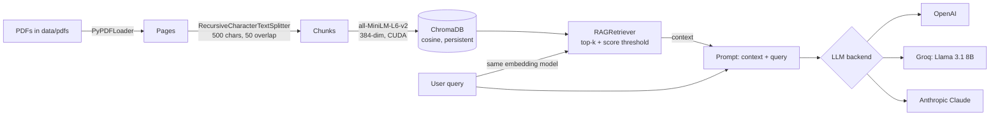

# Retrieval-Augmented Generation (RAG) Pipeline

An end-to-end RAG pipeline built from its parts rather than a framework one-liner: PDF ingestion, chunking, local GPU embeddings with Sentence-Transformers, a persistent **ChromaDB** vector store with cosine similarity, a thresholded retriever, and interchangeable LLM backends (**OpenAI**, **Groq / Llama 3.1**, **Anthropic Claude**) through LangChain.

Everything lives in [`RAG_pipeline.ipynb`](RAG_pipeline.ipynb), split into ingestion, embedding, storage, retrieval and generation stages.

## Architecture



## Components

| Stage | Implementation | Details |
| --- | --- | --- |
| Loading | `load_all_pdfs()` | `PyPDFLoader` over every PDF in `data/pdfs/`, one `Document` per page with source and page metadata |
| Chunking | `split_docs()` | `RecursiveCharacterTextSplitter`, `chunk_size=500`, `chunk_overlap=50` |
| Embedding | `EmbeddingManager` | `sentence-transformers/all-MiniLM-L6-v2`, 384 dimensions, batched encoding on GPU |
| Storage | `VectorStoreManager` | `chromadb.PersistentClient` at `data/vector_store`, collection `pdf_documents`, `hnsw:space = cosine`; stores text, embedding and page metadata per chunk |
| Retrieval | `RAGRetriever.retrieve()` | Embeds the query, takes the top-k neighbours, converts cosine distance to similarity (`1 - distance`) and drops anything below `score_threshold` (default 0.5) |
| Generation | `generate_output()` | Joins the retrieved chunks into the prompt and calls the selected LLM; reports when no relevant context was found |

LLM backends used in the notebook:

| Provider | Model | Package |
| --- | --- | --- |
| OpenAI | `gpt-5.4` | `langchain-openai` |
| Groq | `llama-3.1-8b-instant` | `langchain-groq` |
| Anthropic | `claude-fable-5` | `langchain-anthropic` |

## Current index

The committed vector store holds **480 chunks** from **2 PDFs (170 pages)** of university course material on database modeling and database systems. Queries should be about that domain, for example *"What is a primary key?"* or *"Explain normalization"*. Off-topic questions (such as the *"what is encoder decoder?"* example in the notebook) correctly retrieve nothing above the 0.5 threshold, and the LLM then answers without context.

To index your own documents, put PDFs in `data/pdfs/`, delete `data/vector_store/`, and re-run the ingestion cells.

## Hardware

Developed on an NVIDIA RTX 5060 Ti (16 GB, external GPU over Thunderbolt) with PyTorch 2.14 / CUDA 13. The notebook targets `cuda:0`; on a CPU-only machine, skip the GPU check cell. Sentence-Transformers falls back to CPU automatically.

## Quick start

```bash
git clone https://github.com/AnasMehfooz/RAG-Pipeline.git
cd RAG-Pipeline

python -m venv .venv
source .venv/bin/activate          # Windows: .venv\Scripts\activate

pip install torch langchain-core langchain-community langchain-text-splitters \
    pypdf sentence-transformers chromadb scikit-learn \
    langchain-openai langchain-groq langchain-anthropic jupyterlab
```

Add the API key for the backend you want to use. The notebook reads `API_KEY_OPENAI`, `API_KEY_GROQ` and `API_KEY_ANTHROPIC` from cells; never commit real keys.

```bash
jupyter lab RAG_pipeline.ipynb
```

Run the **Ingestion Pipeline** and **Embedding** sections once to build the index, then the **Retrieval** section and the LLM section of your choice.

## Repository structure

```text
RAG-Pipeline/
├── RAG_pipeline.ipynb     Full pipeline
├── data/
│   ├── pdfs/              Source documents that get indexed
│   ├── vector_store/      Persisted ChromaDB index (480 chunks)
│   └── research2.pdf      RAG survey paper (Gao et al.), not indexed
└── README.md
```

## Roadmap

- Move the pipeline from the notebook into a package and expose it through a FastAPI `/query` endpoint
- Load API keys from environment variables
- Use deterministic chunk IDs so re-running ingestion does not duplicate vectors
- Return source pages with each answer and evaluate retrieval quality on a labelled question set
- Add a local LLM backend through Ollama

## Author

**Anas Mehfooz** · [GitHub](https://github.com/AnasMehfooz) · [LinkedIn](https://www.linkedin.com/in/anas-mehfooz-670501302/)
