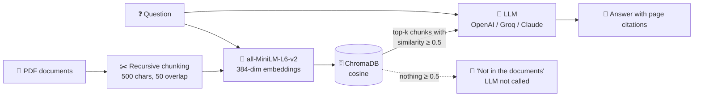

# 🧠 Retrieval-Augmented Generation (RAG) Pipeline

An end-to-end **Retrieval-Augmented Generation (RAG)** pipeline built with **LangChain**, **sentence-transformers** and **ChromaDB**, answering questions about PDF documents with **OpenAI**, **Groq (Llama 3.1)** or **Anthropic Claude**, and citing the pages the answer came from.

---

## 🚀 Overview

The pipeline loads PDF documents, splits them into overlapping chunks, embeds each chunk into a 384-dimensional vector with `all-MiniLM-L6-v2`, and indexes them in a persistent **ChromaDB** collection. A question is embedded the same way; the closest chunks by cosine similarity become the only context the LLM is allowed to answer from.



---

## 🌟 Key Features

- **Grounded answers**: the model only sees the retrieved chunks, each tagged with its page, and is told to answer from them alone and cite pages like `[p. 4]`.
- **No answer without context**: when no chunk clears the similarity threshold, the pipeline says so instead of calling the LLM, so it never falls back to the model's own training data.
- **One prompt, three providers**: the same `generate_output` drives OpenAI (`gpt-5.4`), Groq (`llama-3.1-8b-instant`) and Anthropic (`claude-fable-5`) through LangChain chat models.
- **Re-runnable ingestion**: chunk ids are derived from their content, so re-running ingestion updates the index instead of storing every chunk twice.
- **GPU embeddings when available**: sentence-transformers uses CUDA if present (developed on an RTX 5060 Ti), otherwise the CPU.

---

## 📊 Retrieval on the sample document

`data/pdfs/rag_survey.pdf` (21 pages) becomes **244 chunks**. Best cosine similarity per question:

| Question | Best match | Retrieved? |
| --- | --- | --- |
| What are the differences between naive RAG and advanced RAG? | 0.797 | ✅ |
| How is RAG evaluated? | 0.739 | ✅ |
| What is retrieval-augmented generation? | 0.735 | ✅ |
| What are the limitations of fine-tuning compared to RAG? | 0.701 | ✅ |
| What is query rewriting? | 0.686 | ✅ |
| How does chunk size affect retrieval? | 0.558 | ✅ |
| What is encoder decoder? | 0.426 | ❌ barely covered by the paper |
| How are you doing? | 0.248 | ❌ off-topic |

Questions the paper answers score 0.55–0.80; off-topic ones stay below 0.45. The 0.5 threshold sits in that gap.

---

## 📁 Repository Structure

```
RAG-Pipeline/
├── data/
│   ├── pdfs/
│   │   └── rag_survey.pdf  # Source document: a survey of RAG for LLMs
│   └── vector_store/       # ChromaDB index, built locally by the notebook (git-ignored)
├── .gitignore
├── RAG_pipeline.ipynb      # End-to-end notebook: ingestion, retrieval, generation
└── README.md
```

---

## 🛠️ Quickstart

### 1. Clone the repository
```bash
git clone https://github.com/AnasMehfooz/RAG-Pipeline.git
cd RAG-Pipeline
```

### 2. Create a virtual environment
```bash
python -m venv .venv
# Windows:
.venv\Scripts\activate
# macOS / Linux:
source .venv/bin/activate
```

### 3. Install requirements
```bash
pip install langchain-core langchain-community langchain-text-splitters langchain-openai langchain-groq langchain-anthropic chromadb pypdf sentence-transformers torch
```

### 4. Set your API keys
Only the providers you want to try are needed. Set them in your shell or a `.env` file:
```env
OPENAI_API_KEY=your_openai_api_key_here
GROQ_API_KEY=your_groq_api_key_here
ANTHROPIC_API_KEY=your_anthropic_api_key_here
```

### 5. Run the notebook
```bash
jupyter lab
```
Open `RAG_pipeline.ipynb` and run the cells top to bottom. The first run builds `data/vector_store/`; to rebuild it from scratch (for example after changing the PDFs), delete that folder first.

---

## 💡 How It Works

1. **Loading**: `PyPDFLoader` reads every PDF in `data/pdfs/`, one document per page, keeping the page number.
2. **Chunking**: `RecursiveCharacterTextSplitter` cuts pages into 500-character chunks with a 50-character overlap.
3. **Embedding**: `all-MiniLM-L6-v2` turns each chunk into a 384-dimensional vector.
4. **Indexing**: chunks, vectors and metadata are upserted into a ChromaDB collection using cosine distance.
5. **Retrieval**: the question is embedded and the top 5 chunks are fetched (top 3 for generation); anything below 0.5 similarity is dropped.
6. **Generation**: the surviving chunks, tagged with their pages, go to the LLM with a system prompt that restricts it to that context and asks for citations. With no surviving chunks, the pipeline answers "not in the documents" without calling the LLM.

---

## 👤 Author

**Anas Mehfooz**
- GitHub: [@AnasMehfooz](https://github.com/AnasMehfooz)
